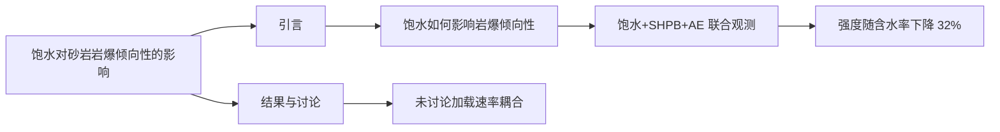
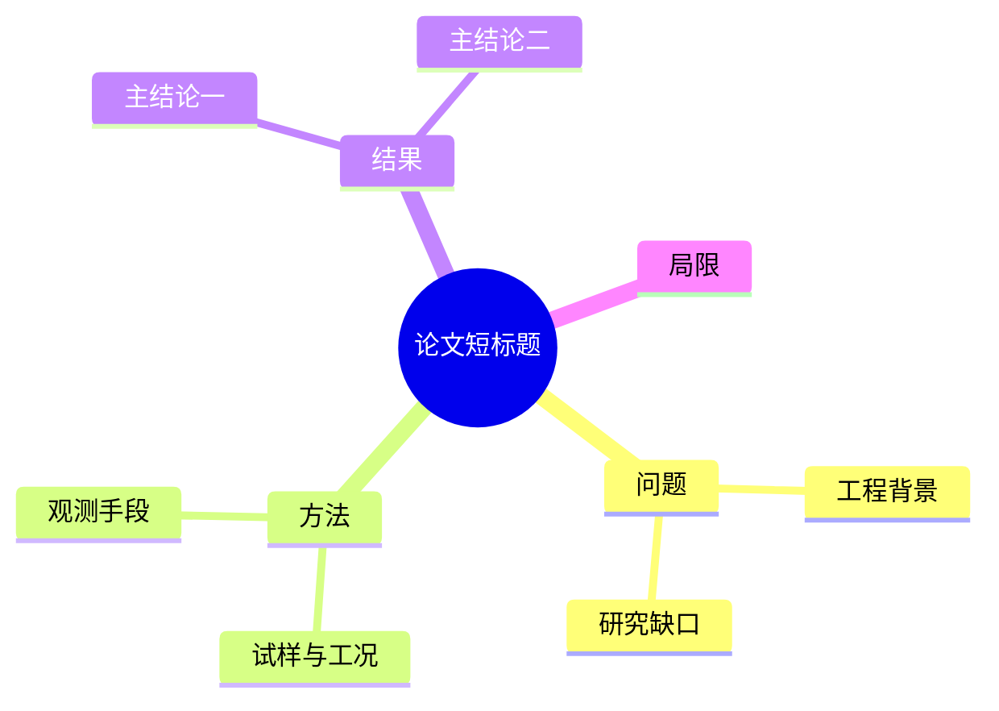

# 画图：Mermaid → SVG（PPT 可编辑）

## 1. 渲染命令（实测通过）

```bash
mmdc -i maps/v1/mindmap.mmd -o maps/v1/mindmap.svg \
     -c templates/mermaid.json -b white -q
mmdc -i maps/v1/mindmap.mmd -o maps/v1/mindmap.png \
     -c templates/mermaid.json -b white --size 1600 -s 2 -q
```

- `--size` 是最大边像素（不是 `-w`，v12 无 `-w`）。
- `-s 2` 是 puppeteer 缩放，PNG 更清晰；SVG 不受影响。
- 统一用 `scripts/render_maps.py`，它会**检查 foreignObject** 并回写 `render.log`。

## 2. 配置（`templates/mermaid.json`）

```json
{
  "htmlLabels": false,
  "theme": "base",
  "themeVariables": {
    "fontFamily": "Microsoft YaHei, sans-serif",
    "fontSize": "18px",
    "primaryColor": "#eef4ff",
    "primaryBorderColor": "#3b6fb6",
    "lineColor": "#7a8899",
    "cScale0": "#1f4e79", "cScale1": "#2e75b6", "cScale2": "#5b9bd5",
    "cScale3": "#a5c9e8", "cScale4": "#dbe8f5",
    "cScaleLabel0": "#ffffff", "cScaleLabel1": "#ffffff",
    "cScaleLabel2": "#ffffff", "cScaleLabel3": "#1f2d3d", "cScaleLabel4": "#1f2d3d"
  },
  "flowchart": { "curve": "linear", "nodeSpacing": 28, "rankSpacing": 48 }
}
```

两个实测结论：

1. **`htmlLabels:false` 必须在顶层**。写在 `flowchart.htmlLabels` 里不生效，仍然输出 `foreignObject` → PowerPoint 里文字消失。
2. `cScaleN` 控制 mindmap 每层配色；`themeVariables.fontFamily` 控制中文回退字体。

## 3. 图的角色与写法（四张：结构树为主，其余辅助说明）

| 图 | 角色 | 看什么 |
|---|---|---|
| `tree.mmd` | **思维导图（主产出）** | 论文结构展开：章节→节点→子节点；综述知识框架 |
| `timeline.mmd` | **时间脉络（综述类）** | 按年份/阶段展开领域进展，看历史脉络 |
| `mindmap.mmd` | 脑图（辅助） | 概念/节点间的关联 |
| `hierarchy.mmd` | 层次图（辅助） | 论证链：问题→Gap→方法→证据→结论→局限 |
| `flow.mmd` | 流程图（辅助） | 试验方法/做法链（取样→加载→观测） |

## 2. 选图：拓扑优先，画像弱先验（agent 决定）

主图 1 张，由 `knowledge.json` 的**拓扑特征**决定（见 `core/principles.md` §2）；`content_profile` 只作弱先验修正。下表是常见情况的例示，**不是硬映射**——同一篇可双图，也允许表外选择：

| 拓扑特征（优先判断） | 画像修正（弱先验） | 主图倾向 | 辅助 | 说明 |
|---|---|---|---|---|
| 分支多且平级（主题→各方法→特点） | 综述/方法对比 | `tree`（知识框架）**或** `timeline`（有时间脉络时），agent 自选、都有可双图 | `mindmap` | 知识框架看结构，时间线看脉络 |
| 流程/因果链明显（取样→加载→观测 / 建模→校准→验证→结果） | 试验/数值模拟 | `flow` | `tree`（结果分级）、`mindmap` | 结果可再分级：不同工况→数值/趋势 |
| 推导链（假设→推导→适用条件→验证） | 理论 | `flow` | `hierarchy` | 推导链为核，hierarchy 仅论证角色梯（每层 top3） |
| 案例/现场结构平展开 | 工程案例 | `tree` 或 `timeline`（监测脉络） | `mindmap` | 案例→概况→监测→数据→分析，agent 自选 |

选型理由写进 manifest 汇报里一句话即可（L1 覆盖说明）。

### 结构树（思维导图·主产出）`tree.mmd`

把论文结构展开成树状分层：**标题 → 章节(outline) → 一级节点 → 子节点**，横向 `graph LR`。这是"思维导图"——一看就懂论文内容。



规则：
- 根=论文标题（meta.title）；第二层=outline 章节（按顺序）；第三层起=节点树（按 parent 挂树，递归至 `budget.depth`）。
- 每章节 ≤ `tree_per_section`(8) 个一级节点（结果/分析节常多个结果，需全显）；每节点 ≤ `tree_children`(11) 个子节点（知识框架分支如 11 类指标需全显）。
- 无章节归属的一级节点直接挂标题；节点文字避开 `[]{}|`（`()` 在引号内安全，保留单位）。
- 标签 ≤ 30 字、每行 ≤ 18 字（`node_label(30,18)`，关键数值/单位完整可见）；数字区间断行在连字符 `–` 后，不断数字；被批注节点加 `★` 前缀。

### 脑图（理解·辅助）`mindmap.mmd`



规则：

- 分支固定 4–6 个（问题/方法/结果/局限/与你研究的关系）。
- 每个分支 ≤ 6 个子节点；标签 ≤ 18 字，超出换行用 `<br/>`。
- mindmap 不支持 `classDef`，被批注节点用前缀 `★` 标记。
- 标签内不要出现 `(` `)` `[` `]` `{` `}` `|`，这些字符会破坏解析。

### 层次图（论证）`hierarchy.mmd`


规则：

- 固定 rank 顺序：问题 → Gap → 方法 → 证据 → 结论 → 局限；横向 `LR` 比 `TD` 更适合 16:9。
- 每个 rank 最多 4 个节点，多了合并到 `evidence` 层的子图。
- 被批注 ≥ 1 条的节点加 `hot`；同时被 Red 批注的用 `hot2`（更深的橙）。

### 流程图（方法）`flow.mmd`


规则：

- 只画**方法链**，不画结论；结论属于层次图。
- 每个节点两行：动作 + 参数/对象。
- ≤ 9 步；循环用 `-.->|条件|` 回边，不要画成环。

## 4. 预算与聚合

超预算时的处理顺序（**不要先缩字号**）：

1. 同父节点下 `importance < 0.4` 且无批注的兄弟 → 合并为一条 `其他：A、B、C`。
2. 只保留 `outline` 的一级章节作为分支，二级章节折叠成一句话。
3. 仍超 → 生成两张图（`mindmap-1/2`）并在 README 里说明拆分依据。

## 5. 进 PPT 的额外要求

- SVG 根节点必须有 `viewBox`（mmdc 默认有）；宽高比控制在 1.3–1.9 之间，接近 16:9。
- 图内字号 ≥ 14px，否则投影看不清。
- 不要用 markmap：它用 `foreignObject` 渲染，PowerPoint 里会变空白。需要交互式浏览时另存 HTML，不放进 PPT。
- **mindmap 在 PowerPoint 里会丢字**（实测：`--svg-backend com` 插入 `mindmap.svg`，约 1/3 的"深底白字"节点渲染成空白框）。`build_deck.py` 已对 `mindmap*` 自动改用同名 PNG；可编辑 SVG 仍在 `maps/`。层次图/流程图不受影响。
- **节点文字别顶满**：PowerPoint 的 SVG 文本度量比 Chrome 略宽，`kmap2mmd.py` 已把 hierarchy 的 `per_line` 压到 7、limit 压到 14 预留余量；手写 .mmd 时同样留 1 行余量。
- 深色背景主题不要用于 PPT（打印/投影都会糊），统一白底。

## 6. 自检（每次渲染后）

```bash
grep -c foreignObject maps/v1/*.svg     # 必须全是 0
grep -o 'viewBox="[^"]*"' maps/v1/*.svg # 必须存在
```

再看一眼 PNG 缩略图：节点有没有重叠、箭头有没有穿字、中文有没有变方框。
